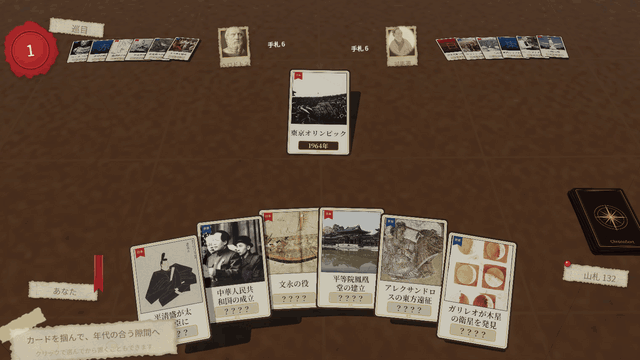

# ChronoSort

歴史の出来事カードを、年表の正しい位置へ差し込んでいく 3D カードゲームです。

> 🚧 現在開発中です。内容は今後変わる可能性があります。

## ゲーム概要

卓の上には、年号の見えている出来事カードが年代順に並んでいます。
手札のカードには題名と絵だけが描かれ、年号は伏せられています。

「マラトンの戦い」と「カエサル暗殺」のあいだか、それとも後か——
手札を 1 枚選び、年代が合うと思う隙間へ置きます。
カードが裏返って年号が明かされ、合っていれば朱印が押されて年表に加わります。
外れたカードは捨て札になり、山札から新しく 1 枚引かされます。

ボードゲーム「Timeline」のルールに沿っています。

## モード

### ひとりで挑む

インク壺（ライフ）は 3 つ。間違えるたびに 1 つ減り、尽きると終わりです。
手札は常に 3 枚に補充され、何枚並べられるかを競います。
続けて正解すると連続ボーナス、年代の近いカードのすぐ隣に正しく置けるとさらにボーナスが入ります。

### CPU と対戦

1〜3 人の CPU（やさしい / ふつう / てごわい）と順番にカードを置き、
先に手札を出し切った人の勝ちです。同じラウンドで複数人が出し切ったときは延長戦になります。

## 収録カード

| デッキ | 枚数 |
|---|---|
| 世界史 | 75 枚 |
| 日本史 | 76 枚 |

古代オリンピックから東日本大震災まで、紀元前から現代にわたる出来事を収録しています。

## 見どころ

- 卓の上に実際にカードを置いて遊ぶ 3D の盤面
- カードを運び、裏返し、叩きつけて判定する演出
- 紙片・封蝋・インク壺・朱印など、机の上の小物を模した UI

## クレジット

カードの絵は Wikimedia Commons のパブリックドメイン / CC0 / CC BY の画像を使用しています。
各画像の出典はゲーム内の「出典・クレジット」に記載しています。
